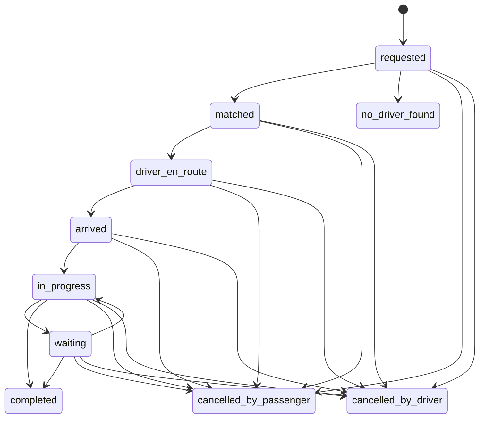
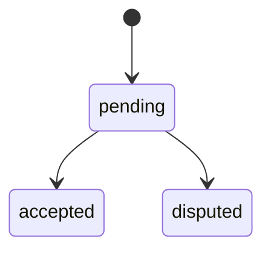

# Contrat API DiddiGo — HTTP et WebSocket

Version documentaire : `draft.2026-10-20`. Périmètre : implémentation locale, applications passager/chauffeur, Backoffice et services internes.

Ce contrat est exploitable comme référence d'intégration, mais reste un **brouillon incomplet** : les réponses HTTP non typées et les décisions non vérifiées sont recensées dans [open-questions.md](open-questions.md). Il ne certifie pas la version déployée : le contrôle staging du 14 octobre 2026 à 18:38 UTC exposait encore 136 opérations, contre 138 dans le dépôt.

## Références et navigation

Ce dossier contient uniquement quatre fichiers. Les règles humaines sont maintenues ici ; les schémas HTTP dans [openapi.yaml](openapi.yaml), les messages WebSocket dans [asyncapi.yaml](asyncapi.yaml), et les questions techniques/MVP dans [open-questions.md](open-questions.md).

- [HTTP et autorisation](#connexion-http)
- [WebSocket](#websocket) et [reconnexion](#reconnexion)
- [Conventions](#conventions) et [erreurs](#erreurs)
- [États et transitions](#states)
- [Inventaire HTTP généré](#inventaire-http)

`openapi.yaml` est l'unique spécification HTTP publiée dans ce dépôt. Elle est dérivée du code et enrichie documentairement ; le JSON servi à l'URL runtime `/openapi.json` peut encore différer. Cette limite reste suivie dans les questions ouvertes et ne crée pas une seconde spécification locale.

Chaque opération contient `x-contract`, avec `UNKNOWN` lorsque les garanties ne sont pas établies. Sources : routeurs, services, dépendances d'authentification et gestionnaire WebSocket locaux ; les archives ne définissent pas le contrat courant.

## Connexion HTTP

Base staging connue : `https://go-staging.diddifree.com`. Les chemins OpenAPI sont absolus par rapport à cette base : ne pas ajouter systématiquement `/v1`, car les retours de paiement et les routes internes utilisent d'autres préfixes.

| Surface | Authentification | Autorisation |
|---|---|---|
| Routes utilisateur protégées | `Authorization: Bearer <access_token>` | Propriétaire, chauffeur affecté, profil métier ou administrateur selon l'opération |
| Administration humaine | JWT utilisateur administrateur | Contrôle serveur ; `/v1/admin/*` ne couvre pas toutes les routes KYC/KYV administratives |
| Services internes protégés | JWT S2S et `X-Client-ID` | Audience, subject et scopes de la dépendance de chaque route ; liste exhaustive encore `UNKNOWN` |
| Commandes Backoffice S2S | S2S, plus en-têtes documentés par opération | `X-Request-ID`, `Idempotency-Key`, acteur canonique `X-Backoffice-Actor` ; `X-User-ID` est l'alias historique |
| `POST /internal/webhooks/diddipay` | HMAC-SHA256 du corps brut via `X-DiddiPay-Signature`, plus `X-DiddiPay-Event-ID` égal à `payload.id` | Exception au JWT S2S ; payload partiellement documenté, voir questions ouvertes |
| Santé, recherche de lieux, liens partagés et retours navigateur | Selon la sécurité de l'opération | L'absence de JWT ne rend pas une donnée privée publique ; un lien partagé utilise son token |

Un JWT valide ne suffit pas à autoriser l'accès à une course. Un refus d'identité retourne notamment `401 TOKEN_MISSING`, `TOKEN_INVALID` ou `TOKEN_EXPIRED` ; un refus de participation peut retourner `403 RIDE_NOT_OWNED_BY_USER`.

## Parcours HTTP public

Les erreurs indiquées sont les principales erreurs connues, pas une liste exhaustive. Les schémas et exemples disponibles sont référencés par opération dans OpenAPI.

| Opération | Acteur / précondition | Résultat ou changement | Rejeu et reprise |
|---|---|---|---|
| `POST /v1/rides/pricing/estimate` | Utilisateur authentifié, trajet valide | Devis avec `quote_id`, `expires_at` | Un nouveau trajet exige un nouveau devis ; panne DiddiMap explicite |
| `POST /v1/rides` | Passager, devis valide non consommé | Création et matching ; offre éventuelle aux chauffeurs | Garantie après perte de réponse `UNKNOWN` ; ne pas supposer une clé d'idempotence client |
| `GET /v1/rides/{ride_id}` | Propriétaire, chauffeur affecté ou admin | État de référence ; visibilité des données selon le rôle | Lecture de resynchronisation après mutation ou reconnexion |
| `POST /v1/rides/{ride_id}/accept` | Chauffeur autorisé par le matching | Affectation si l'offre est encore recevable | Ne pas considérer la réception d'une offre comme une réservation |
| `POST /v1/rides/{ride_id}/arrive` | Chauffeur affecté/admin ; position récente dans le rayon admis | `arrived`, début de l'attente pré-course | `ARRIVAL_INVALID_RIDE_STATUS`, `DRIVER_LOCATION_REQUIRED`, `DRIVER_TOO_FAR_FROM_PICKUP` |
| `POST /v1/rides/{ride_id}/start` | Chauffeur affecté/admin, code passager à six chiffres | `in_progress`, calcul de l'attente pré-course | Mauvais code : 422 ; blocage persistant : 423 ; pas de retry aveugle |
| `POST /v1/rides/{ride_id}/no-show` | Chauffeur affecté/admin, délai pré-course atteint | Annulation pour absence ; attente pré-course non facturée | Avant délai : `409 NO_SHOW_TOO_EARLY`, `details.remaining_seconds` |
| `POST /v1/rides/{ride_id}/waiting/start` | `in_progress`, chauffeur affecté/admin, vitesse récente sous seuil | `waiting`, notification d'état et d'attente | Télémétrie absente : `WAITING_TELEMETRY_REQUIRED` ; véhicule mobile : `VEHICLE_NOT_STOPPED` |
| `POST /v1/rides/{ride_id}/waiting/stop` | Chauffeur affecté/admin | `in_progress`, montant d'attente calculé | Relire la course ; une reprise via `PATCH /status` est refusée |
| `POST /v1/rides/{ride_id}/location-samples` | Chauffeur affecté ; 1 à 120 points | Trace durable, `accepted_samples`, `batch_id`, `replayed` | Même corps et même UUID : rejeu ; corps différent : `409 GPS_BATCH_IDEMPOTENCY_CONFLICT` |
| `POST /v1/rides/{ride_id}/supplements` | Chauffeur affecté/admin | Proposition `pending`, sans facturation immédiate | Aucun identifiant client de déduplication documenté |
| `POST /v1/rides/{ride_id}/supplements/{supplement_id}/decision` | Passager propriétaire/admin ; course in_progress ou waiting | `accepted` ou `disputed` ; seules les lignes acceptées modifient le total | Même décision idempotente tant que la course est active ; changement terminal : `409 SUPPLEMENT_ALREADY_DECIDED` |
| `PATCH /v1/rides/{ride_id}/status` | Chauffeur affecté/admin, transition autorisée | Fin normale via `completed`, calcul du prix | Répéter `completed` retourne la course déjà terminée ; ne pas utiliser cette route pour contourner `/start` |
| `POST /v1/rides/{ride_id}/cancel` | Participant/admin, course non terminale | Statut d'annulation passager ou chauffeur selon acteur/motif | Déjà annulée : `409 RIDE_ALREADY_CANCELLED` ; relire la course |
| `POST /v1/rides/{ride_id}/emergency` | Participant autorisé ; quota respecté | Alerte persistée puis résultats de notification | `429 EMERGENCY_RATE_LIMITED`, `details.retry_after_seconds` ; pas de garantie de livraison de tous les canaux |

### Arrêt anticipé

Le passager propriétaire demande `POST /v1/rides/{ride_id}/early-stop/request` en `in_progress` ou `waiting`. La réponse contient un montant provisoire et une expiration deux minutes après la demande ; répéter la demande renouvelle cette fenêtre dans le code actuel.

Le chauffeur affecté ou un admin confirme via `POST /v1/rides/{ride_id}/early-stop/confirm`. La trace exploitable produit le montant final, puis `status=completed` et `completion_reason=early_stop` ; l'absence de tarification exploitable retourne `503 EARLY_STOP_PRICING_UNAVAILABLE`.

Erreurs connues : `403 RIDE_NOT_OWNED_BY_USER`, `409 EARLY_STOP_INVALID_RIDE_STATUS`, `EARLY_STOP_NOT_REQUESTED`, `EARLY_STOP_REQUEST_EXPIRED`. Après perte de réponse de confirmation, relire la course : une nouvelle confirmation après succès rencontre une course terminale et n'est pas un rejeu idempotent garanti.

La demande émet `ride.status_changed` avec `status=early_stop_requested`. **Cette valeur est une notification, pas un état persisté de la course.** Relire REST et le champ `early_stop` ; ne pas remplacer l'état canonique par cette valeur.

### Paiements et wallet

| Opération | Règle |
|---|---|
| Création de course | `payment_method` vaut `cash` ou `mobile_money` ; les anciennes méthodes de recharge wallet ne sont pas des méthodes de course |
| `POST /v1/payments/{ride_id}/prepare` | Envoyer explicitement `method=mobile_money` et `mobile_money_network=orange|wave|mtn` ; avec `cash`, ne pas envoyer de réseau |
| Reprise numérique | Une intention active est réutilisée ; une intention terminale admissible ou expirée peut être remplacée ; relire `GET /v1/payments/{ride_id}` après retour navigateur |
| `POST /v1/payments/{ride_id}/confirm-cash` | Chauffeur affecté disposant d'un profil, corps `amount_collected` ; ne pas déduire le paiement d'un écran de succès |
| `POST /v1/drivers/me/wallet/withdrawals/quote` | Devis serveur : montant, frais, net, devise, expiration |
| `POST /v1/drivers/me/wallet/withdrawals` | `quote_id`, `beneficiary_reference`, `beneficiary_destination` obligatoires ; destination Mobile Money avec téléphone E.164 |
| Retry retrait | Le dépôt retrouve le retrait lié au devis consommé ; le contrat de changement de bénéficiaire sur rejeu reste `UNKNOWN` |
| Retour paiement | Pages HTML `/payments/return` et `/wallet/return` ; REST reste la source financière de vérité |
| Webhook DiddiPay | Réponse vide 204 pour traitement normal, 200 pour doublon ; signature invalide : 401 ; secret absent : 503 |

### Prix et configuration

Course normale : devis accepté + attente pré-course + attente en course + suppléments acceptés. La trace GPS ne remplace pas silencieusement le devis ; l'arrêt anticipé utilise une tarification réelle spécifique.

L'attente pré-course est proratisée à la seconde après franchise ; l'attente en course facture chaque minute commencée. Utiliser les valeurs de `/arrive`, les montants REST et `online_requirements.wallet` ; les valeurs par défaut dans la documentation ne prouvent pas les paramètres de staging.

## HTTP et temps réel ensemble

1. Obtenir une session valide puis lire la course par HTTP.
2. Ouvrir `wss://<hote>/v1/ws?token=<access_token>` et envoyer `ride.subscribe`.
3. Après l'accusé de souscription, relire REST pour réduire la fenêtre entre lecture initiale et abonnement.
4. Utiliser les événements pour déclencher une actualisation ; conserver REST comme référence de statut et de prix.
5. Après coupure, reconnecter, se réabonner et relire REST ; aucun historique WebSocket n'est rejoué.

Cette séquence ne fournit pas de snapshot atomique ni de numéro de révision. Une garantie d'ordre total REST/WebSocket reste `UNKNOWN` ; ne pas fusionner aveuglément des états anciens et récents.

## Limites d'intégration connues

- WebSocket local au processus, sans bus Redis inter-instance ni rétention/replay ; le déploiement multi-processus doit être vérifié.
- Certaines réponses HTTP restent ouvertes (`additionalProperties`) ; cela signifie « champs non spécifiés », pas « réponse vide ».
- Les canaux SOS `sent`, `failed`, `skipped` décrivent le résultat fournisseur ; SMS reste un écart MVP déclaré.
- Les purposes DiddiFiles manquants ne sont pas inventés par ce contrat.
- Les escales exposées techniquement restent hors activation produit MVP.
- Aucune livraison exactement une fois, durée de timeout client universelle, ni politique globale de retry n'est garantie.


## Précisions Public, Backoffice et S2S

Le devis est valable 15 minutes par défaut ; utiliser `expires_at` plutôt qu'une constante client. Un changement de trajet, catégorie ou confort exige un nouveau devis ; le changement de réseau Mobile Money n'invalide pas le devis.

Si l'e-mail DiddiFreeID manque, le parcours paiement peut utiliser `<telephone>@diddifree.com` comme adresse technique ; cela ne modifie pas l'identité utilisateur. Le QR de départ est construit localement avec `ride_id + code`, puis validé par l'appel HTTP /start.

Les JWT des dépendances S2S contrôlent notamment `iss`, `sub`, `aud`, `client_id`, `scope`, `status=active` et la cohérence de `X-Client-ID`. Les appels internes ne sont pas destinés aux applications publiques ; les secrets client ne leur sont jamais transmis. Le webhook HMAC reste l'exception décrite dans la matrice HTTP.

### Scores intermodules

`GET /internal/v1/scores/users/{user_id}` et
`GET /internal/v1/scores/rides/{ride_id}` sont reserves a DiddiFree Pro. Ils
retournent `diddi.score.v1`, exigent le scope `diddigo:scores:read` et ne
remplacent pas les routes publiques de score. Le contrat detaille est dans
[l'integration DiddiFree Pro](../integrations/diddifree-score.md).

Le Backoffice dispose de KYC/KYV, partenaires, véhicules, wallet/retraits, paiements et logs, via routes administratives ou S2S explicitement prévues. Les décisions administratives sont auditées ; les fichiers privés sont consultés par URL signée DiddiFiles. Le préfixe /v1/admin ne décrit pas à lui seul toutes les permissions.

<a id="conventions"></a>

## Conventions

Portée : code local au 20 octobre 2026 ; version déployée à contrôler séparément.

| Sujet | Convention observée |
|---|---|
| Transport | HTTPS pour HTTP ; WSS pour le socket ; JSON sauf retours navigateur HTML et réponses sans contenu |
| Identifiants | UUID lorsque le schéma le déclare ; `beneficiary_reference` reste une chaîne métier opaque |
| Horodatages | ISO 8601 ; émissions WebSocket `at` en UTC avec suffixe `Z` ; respecter les formats des schémas HTTP |
| Montants | Montants XOF exposés par les parcours examinés en unités entières ; ne pas diviser par 100 ; toute autre devise ou règle d'arrondi reste à documenter |
| Téléphone retrait | E.164, motif exact dans `MobileMoneyBeneficiaryDestination` ; ne pas étendre cette validation aux champs historiques non contraints |
| Champs absents/null | `required` définit la présence ; type nullable définit `null` ; un champ nullable requis doit quand même être présent |
| Pagination | Paramètres propres à chaque opération ; ne pas imposer de pagination aux listes qui n'en déclarent pas ; enveloppes non typées : `UNKNOWN` |
| Auth utilisateur | JWT accès Bearer ; ne jamais utiliser le refresh token comme jeton d'accès |
| Expiration session | Mode local : défaut accès 15 min, refresh 30 jours ; valeurs configurables ; durées DiddiFreeID non déduites de ces défauts |
| Auth socket | Jeton accès dans la query `token` ; validation à la connexion ; revalidation en cours de socket non garantie |
| En-tête de corrélation | `X-Request-ID` et `error.request_id` quand présents ; ce n'est pas une clé d'idempotence |
| Enum inconnue | Ne pas déduire une nouvelle permission ou transition ; relire l'état et tolérer les notifications futures |
| Version | `draft.2026-10-20` pour ce dossier ; `0.1.0` applicatif n'identifie pas un build staging |

### Erreurs HTTP

Le schéma `ApiErrorEnvelope` dans [openapi.yaml](openapi.yaml) décrit les exceptions métier locales : objet `error`, `code`, `message`, `details`, identifiant de requête optionnel. `details` varie selon le code ; piloter les actions par `code`, pas par le texte français.

Le handler local de validation produit `422 VALIDATION_ERROR` avec `details.violations`. L'export FastAPI brut conserve un schéma `HTTPValidationError` différent ; le YAML enrichi remplace les réponses 422 JSON par l'enveloppe locale. Les 404/405 du routeur et les erreurs d'un proxy peuvent encore utiliser un autre format ; ne pas supposer que toute réponse non-2xx possède `error.code`.

Le diagnostic HTTP de `/v1/ws` retourne 426 avec `code`, `message`, `path` au premier niveau. Les erreurs WebSocket sont des messages `event=error` distincts, décrits dans AsyncAPI.

### Idempotence et indisponibilité

Réutiliser `batch_id` et le même corps pour un lot GPS durable. Réutiliser les en-têtes d'idempotence S2S seulement sur les opérations qui les déclarent ; durée de rétention et portée exactes non établies : `UNKNOWN`.

Après timeout d'une mutation, rechercher d'abord l'état du résultat connu ; un timeout ne prouve pas un échec. Pour une opération dont le rejeu est `UNKNOWN`, ne pas annoncer une garantie contre les doublons.

Une erreur Redis/SQLAlchemy prise par le handler d'infrastructure produit respectivement `503 CACHE_UNAVAILABLE` ou `503 DATABASE_UNAVAILABLE`. La récupération de chaque intégration externe reste propre à l'opération et peut produire d'autres erreurs ; les listes partielles ne sont pas exhaustives.

En cas de 429, utiliser le délai exposé lorsque présent (`details.retry_after_seconds` pour SOS). Le backoff avec jitter est une stratégie client proposée, pas un SLA serveur.

<a id="erreurs"></a>

## Catalogue des erreurs

Format standard :

```json
{"error":{"code":"CODE","message":"Message lisible","details":{}}}
```

| HTTP | Code | Signification | Action client |
|---:|---|---|---|
| 401 | `TOKEN_MISSING` | Jeton absent | Reconnecter l'utilisateur |
| 401 | `TOKEN_INVALID` | Jeton non valide | Reconnecter l'utilisateur |
| 401 | `TOKEN_EXPIRED` | Jeton expire | Rafraichir ou reconnecter |
| 403 | `RIDE_NOT_OWNED_BY_USER` | Utilisateur non participant | Ne pas rejouer |
| 409 | `ARRIVAL_INVALID_RIDE_STATUS` | Arrivee impossible dans cet etat | Relire la course |
| 422 | `DRIVER_LOCATION_REQUIRED` | Position recente absente | Renvoyer une position GPS |
| 422 | `DRIVER_TOO_FAR_FROM_PICKUP` | Chauffeur hors rayon | Afficher `distance_meters` et `maximum_meters` |
| 409 | `NO_SHOW_INVALID_RIDE_STATUS` | Attente pre-course inactive | Relire la course |
| 409 | `NO_SHOW_TOO_EARLY` | Delai de 10 minutes non atteint | Utiliser `remaining_seconds` |
| 409 | `WAITING_TELEMETRY_REQUIRED` | Vitesse GPS recente absente | Publier une position puis rejouer |
| 409 | `VEHICLE_NOT_STOPPED` | Vitesse superieure au seuil | Afficher `speed_kmh` et `maximum_kmh` |
| 422 | `INVALID_SUPPLEMENT_TYPE` | Type de supplement inconnu | Recharger le catalogue |
| 422 | `INVALID_SUPPLEMENT_AMOUNT` | Montant hors regle | Afficher le tarif contractuel |
| 409 | `SUPPLEMENT_ALREADY_DECIDED` | Proposition deja traitee | Relire les supplements |
| 422 | `VALIDATION_ERROR` | Corps, chemin ou paramètres invalides | Corriger `details.violations` |
| 422 | `INVALID_PAYMENT_METHOD` | Moyen ou réseau de paiement invalide | Utiliser le contrat typé |
| 409 | `PAYMENT_OPERATION_CONFLICT` | Choix ou état de paiement incompatible | Relire la course et le paiement |
| 409 | `EARLY_STOP_INVALID_RIDE_STATUS` | Arrêt anticipé indisponible dans cet état | Relire la course |
| 409 | `EARLY_STOP_NOT_REQUESTED` | Aucune demande active | Le passager doit demander l'arrêt |
| 409 | `EARLY_STOP_REQUEST_EXPIRED` | Fenêtre de deux minutes expirée | Refaire la demande |
| 503 | `EARLY_STOP_PRICING_UNAVAILABLE` | Trace chauffeur insuffisante | Conserver la course active et réessayer |

Ce catalogue complete l'OpenAPI. Chaque nouveau code stable doit etre ajoute
dans cette section et dans le changelog du jour.

<a id="websocket"></a>

## WebSocket

Version : `draft.2026-10-20`. Schémas et exemples : [AsyncAPI 3.0](asyncapi.yaml). Parcours HTTP : [contrat unifié](API_CONTRACT.md).

Sources : `ride/presentation/websocket.py`, producteurs dans `router.py` et sérialiseurs dans `application/services.py`. Les opérations AsyncAPI sont vues depuis DiddiGo : receive = client vers serveur, send = serveur vers client.

### Connexion

`wss://<hote-diddigo>/v1/ws?token=<access_token>` utilise un JWT d'accès, jamais un refresh token. Un socket multiplexe les messages par la propriété JSON `event`, sans Socket.IO ni champ `event.type`.

| Situation | Comportement |
|---|---|
| GET HTTP ordinaire /v1/ws | 426, diagnostic WEBSOCKET_UPGRADE_REQUIRED à la racine du JSON |
| Jeton absent/invalide/refresh | Intention de fermeture 4401 avant acceptation ; le handshake ASGI peut répondre HTTP 403 sans trame close observable |
| Connexion autorisée | Upgrade puis messages JSON |
| Redis indisponible pendant une opération cache | error avec CACHE_UNAVAILABLE, retryable=true, puis fermeture 1013 |
| Objet avec événement inconnu | ignored, socket conservé |
| JSON valide non objet | error avec MALFORMED_MESSAGE |
| JSON non décodable ou exception inattendue | Aucun message normalisé garanti ; traiter comme rupture |

Staging a répondu HTTP 403 à un handshake avec jeton invalide le 14 octobre. Un navigateur peut n'exposer qu'un échec de connexion : ne pas attendre exclusivement close 4401 pour rétablir la session.

Le jeton est contrôlé à la connexion. Renouvellement en place, contrôle périodique d'expiration, heartbeat, taille et fréquence maximales : UNKNOWN.

À la déconnexion d'un JWT dont le rôle est littéralement driver, le handler tente de passer la présence hors ligne. Vérifier et rétablir la présence via HTTP après reconnexion ; un profil chauffeur avec un autre rôle JWT ne suit pas nécessairement ce nettoyage.

### Client vers serveur

| Message / schéma | Qui | Effet et réponse | Erreurs |
|---|---|---|---|
| ride.subscribe / RideSubscribe | Propriétaire, chauffeur affecté ou admin | Abonne ce socket ; répéter ne double pas l'abonnement ; ack avec received_event et ride_id | INVALID_RIDE_ID, RIDE_NOT_OWNED_BY_USER |
| driver.location_push / DriverLocationPush | Rôle driver/admin ou profil chauffeur actif ; avec ride_id : affectation ou admin | Télémétrie, éventuel arrêt automatique d'attente, diffusion autorisée ; ack sans ride_id | FORBIDDEN_ROLE, INVALID_LOCATION, INVALID_RIDE_ID, RIDE_NOT_OWNED_BY_USER, CACHE_UNAVAILABLE |

Le handler convertit les coordonnées en nombres sans contrôler les bornes géographiques. Une vitesse négative devient zéro ; une vitesse non convertible est ignorée. heading est transmis sans validation de type. Les producteurs doivent envoyer des mesures cohérentes, sans supposer des rejets serveur inexistants.

La télémétrie peut être enregistrée avant le refus d'un ride_id ; error ne prouve pas l'absence de tout effet partiel. La position d'une course non autorisée n'est pas diffusée par cette branche.

### Serveur vers client

| Message / schéma | Déclencheur et destinataire | Reprise |
|---|---|---|
| ride.status_changed / RideStatusChanged | Changement aux abonnés ; inclut le signal early_stop_requested | GET /v1/rides/{ride_id} |
| ride.driver_location / RideDriverLocation | GPS avec ride_id autorisé vers abonnés ; heading non validé | REST pour état métier ; attendre une position récente |
| ride.no_driver_found / RideNoDriverFound | Matching sans chauffeur vers abonnés ; sans at | GET /v1/rides/{ride_id} |
| ride.new_request / RideNewRequest | Offre aux sockets du chauffeur ciblé sans abonnement préalable | Replay des offres UNKNOWN ; offre ne garantit pas affectation |
| ride.waiting_changed / RideWaitingChanged | Début/fin d'attente via HTTP ou mouvement | GET /v1/rides/{ride_id} |
| ride.supplement_changed / RideSupplementChanged | Proposition/décision vers abonnés ; ride_id dans supplement | GET /v1/rides/{ride_id}/supplements |
| ack / Ack | Traitement d'un message client, vers son socket | Pas de correlation_id ; pas de garantie de persistance durable |
| error / Error | Validation/droits/cache, vers son socket | Corriger ou reconnecter ; format distinct des erreurs HTTP |
| ignored / Ignored | Événement inconnu, vers son socket | N/A — aucune commande reconnue |

early_stop_requested n'est pas un état de RideStatus : relire early_stop et le statut persisté par REST. Ne jamais additionner localement le montant d'une notification de supplément au prix.

### Erreurs

| Code | Action client |
|---|---|
| MALFORMED_MESSAGE | Envoyer un objet JSON |
| FORBIDDEN_ROLE | Arrêter l'envoi GPS pour cette identité ; vérifier les capacités |
| INVALID_LOCATION | Corriger lat/lng et leur conversion numérique |
| INVALID_RIDE_ID | Corriger l'UUID |
| RIDE_NOT_OWNED_BY_USER | Ne pas rejouer avec les mêmes droits |
| CACHE_UNAVAILABLE | Backoff, reconnexion et relecture ; fermeture 1013 attendue |

### Livraison et reprise

- Best effort uniquement aux sockets du processus courant ; aucun bus inter-instance, journal, rétention ou replay.
- Aucun identifiant unique ni séquence globale ; at est l'heure d'émission et n'est pas présent partout.
- Pas d'ordre métier garanti entre producteurs ; traiter les notifications comme invalidations de lecture.
- Un ACK GPS ne garantit pas une insertion durable : utiliser location-samples HTTP avec batch_id.
- Après reconnexion, refaire les abonnements et relire REST après ACK : [stratégie](#reconnexion).

### Redis et broker

N/A pour un contrat public de messages Redis : ce gestionnaire ne publie pas ces notifications sur un broker partagé. Redis sert notamment à la présence/télémétrie et ne fournit pas implicitement de replay. Logs et push sont des transports distincts.

<a id="reconnexion"></a>

## Reconnexion

Stratégie client retenue (Q10), sans garantie de snapshot atomique ni preuve d'implémentation côté application cliente :

1. Vérifier/renouveler le jeton si la session expire ou la connexion est refusée ; l'échec peut être HTTP 403 sans close 4401 observable.
2. Reconnecter avec backoff progressif et jitter ; 1013 indique une dépendance temporairement indisponible.
3. Envoyer ride.subscribe pour les courses pertinentes.
4. Après ACK, relire GET /v1/rides/{ride_id} et les suppléments si nécessaires ; ignorer les réponses HTTP locales devenues obsolètes.
5. Déclencher une relecture sur notification ; ne pas rejouer une addition de frais ou une transition irréversible depuis un événement.
6. Vérifier la présence chauffeur avant de la rétablir par HTTP : la déconnexion peut l'avoir désactivée.

Il n'existe pas de clé de déduplication universelle : certains événements n'ont ni at, ni status, et ride.supplement_changed imbrique ride_id. Les identifiants ciblent une lecture, sans prouver l'unicité d'une livraison.

Pendant une coupure, le polling de la course toutes les 15 secondes est une convention client proposée à adapter aux limites ; ce n'est ni une fréquence garantie ni un mécanisme de récupération des offres perdues.

Replay des offres, séquences, heartbeats et cohérence inter-instance restent des questions ouvertes.

<a id="states"></a>

## États et transitions

### Course

Sources : RideStatus et ALLOWED_TRANSITIONS dans app_base/modules/ride/domain/entities.py ; contrôles supplémentaires dans application/services.py. Le graphe décrit les transitions du domaine, pas une permission de toutes les demander par PATCH.



| De | Vers | Déclencheur / acteur | Refus ou contrainte |
|---|---|---|---|
| Création | requested | Passager, devis valide | Contrôles de devis expiré/consommé |
| requested | matched | Acceptation chauffeur via matching | Disponibilité/offre/affectation contrôlées serveur |
| requested | no_driver_found | Matching sans chauffeur | Transition automatique |
| matched | driver_en_route | Mise en route chauffeur affecté/admin | 403 si non participant |
| driver_en_route | arrived | /arrive, chauffeur affecté/admin et position valide | ARRIVAL_INVALID_RIDE_STATUS, DRIVER_LOCATION_REQUIRED, DRIVER_TOO_FAR_FROM_PICKUP |
| arrived | in_progress | /start, chauffeur affecté/admin, code passager | INVALID_RIDE_START_CODE, RIDE_START_CODE_BLOCKED ; PATCH ne remplace pas /start |
| in_progress | waiting | /waiting/start, chauffeur affecté/admin, télémétrie récente et véhicule arrêté | WAITING_INVALID_RIDE_STATUS, WAITING_TELEMETRY_REQUIRED, VEHICLE_NOT_STOPPED |
| waiting | in_progress | /waiting/stop ou mouvement détecté | PATCH direct : WAITING_STOP_ENDPOINT_REQUIRED |
| in_progress ou waiting | completed | Fin normale ou confirmation early-stop, chauffeur affecté/admin | Early-stop exige demande non expirée et prix réel exploitable |
| requested, matched, driver_en_route, arrived, in_progress, waiting | cancelled_by_passenger ou cancelled_by_driver | /cancel participant/admin ; no-show chauffeur affecté/admin après délai | Choix du statut selon acteur/motif ; cancelled_by_admin n'existe pas |
| completed, cancelled_by_passenger, cancelled_by_driver, no_driver_found | Aucune transition | États terminaux | 409 INVALID_STATUS_TRANSITION au domaine ; erreurs métier spécifiques possibles |

Le mapping exhaustif code/détails par route reste [UNKNOWN](open-questions.md). Répéter PATCH /status vers completed possède une exception idempotente de service ; cela n'ajoute pas d'arête au graphe.

matching et cancelled_by_admin ne sont pas dans l'enum. early_stop_requested est un signal WebSocket ; le statut persistant reste in_progress ou waiting jusqu'à confirmation.

### Supplément

Source : RideService.add_supplement / decide_supplement et _supplement_payload.



| De | Vers | Déclencheur / acteur | Refus |
|---|---|---|---|
| Absent | pending | Proposition chauffeur affecté/admin | Type/montant invalides : 422 ; accès : 403 |
| pending | accepted | Passager propriétaire/admin, course in_progress ou waiting | RIDE_NOT_ACTIVE sinon |
| pending | disputed | Passager propriétaire/admin, course in_progress ou waiting | RIDE_NOT_ACTIVE sinon |
| accepted ou disputed | Même état | Rejeu identique sur course active | Idempotent ; la précondition de course est contrôlée avant le rejeu |
| accepted ou disputed | Autre décision | Interdit | 409 SUPPLEMENT_ALREADY_DECIDED |

Seules les lignes accepted entrent dans le total. Les lignes historiques peuvent avoir été migrées directement en accepted. L'événement enveloppe la ligne dans supplement.

### Autres catalogues d'états

Ces enums sont observés dans le code ; les matrices complètes de transitions, acteurs et refus restent UNKNOWN (Q11). Leur ordre ne définit aucune transition ; la présence Redis ne doit pas être confondue avec l'état du compte chauffeur.

| Entité | États observés | Source |
|---|---|---|
| driver | `pending_verification`, `active`, `suspended`, `offline` | `app_base/modules/ride/domain/entities.py`, `DriverStatus`. |
| vehicle | `pending_verification`, `active`, `suspended`, `rejected` | `app_base/modules/ride/domain/entities.py`, `VehicleVerificationStatus`. |
| partner | `pending_verification`, `active`, `suspended`, `rejected` | `app_base/modules/partner/domain/entities.py`, `PartnerStatus`. |
| payment | `pending`, `requires_action`, `processing`, `succeeded`, `failed`, `cancelled`, `partially_refunded`, `refunded`, `collected`, `disputed` | `app_base/modules/payment/domain/entities.py`, `PaymentStatus`. |
| topup | `pending`, `requires_action`, `processing`, `succeeded`, `failed`, `cancelled` | `app_base/modules/payment/domain/entities.py`, `TopupStatus`. |
| withdrawal | `reserved`, `processing`, `succeeded`, `failed`, `released` | `app_base/modules/payment/domain/entities.py`, `WithdrawalStatus`. |
| wallet-entry | `pending`, `confirmed`, `failed` | `app_base/modules/payment/domain/entities.py`, `WalletEntryStatus`. |


<a id="inventaire-http"></a>
## Inventaire HTTP

<!-- generated:http-inventory:start -->
135 chemins ; 149 opérations HTTP.

| Méthode | Chemin | Opération | Réponses documentées |
|---|---|---|---|
| GET | `/health` | Health | 200 |
| GET | `/internal/pilotage/breakdown` | Get Pilotage Breakdown | 200, 422 |
| GET | `/internal/pilotage/daily-summary` | Get Pilotage Daily Summary | 200, 422 |
| GET | `/internal/pilotage/finance-summary` | Get Pilotage Finance Summary | 200, 422 |
| GET | `/internal/pilotage/health-summary` | Get Pilotage Health Summary | 200, 422 |
| GET | `/internal/v1/admin/dispatch/config` | Get Dispatch Config | 200, 422 |
| PUT | `/internal/v1/admin/dispatch/config` | Put Dispatch Config | 200, 422 |
| GET | `/internal/v1/admin/dispatch/drivers/{driver_id}/priority` | Get Driver Priority | 200, 422 |
| POST | `/internal/v1/admin/dispatch/priority-boosts` | Grant Priority Boost | 201, 422 |
| GET | `/internal/v1/admin/dispatch/priority-rules` | List Priority Rules | 200, 422 |
| GET | `/internal/v1/admin/partners` | List Partners | 200, 422 |
| POST | `/internal/v1/admin/partners` | Create Partner | 201, 422 |
| GET | `/internal/v1/admin/partners/{partner_id}` | Get Partner | 200, 422 |
| PATCH | `/internal/v1/admin/partners/{partner_id}` | Update Partner | 200, 422 |
| POST | `/internal/v1/admin/partners/{partner_id}/activate` | Activate Partner | 200, 422 |
| GET | `/internal/v1/admin/partners/{partner_id}/drivers` | List Drivers | 200, 422 |
| POST | `/internal/v1/admin/partners/{partner_id}/drivers` | Affiliate Driver | 201, 422 |
| DELETE | `/internal/v1/admin/partners/{partner_id}/drivers/{driver_id}` | Unaffiliate Driver | 200, 422 |
| PATCH | `/internal/v1/admin/partners/{partner_id}/kyc` | Submit Partner Kyc | 200, 422 |
| POST | `/internal/v1/admin/partners/{partner_id}/kyc/approve` | Approve Partner Kyc | 200, 422 |
| POST | `/internal/v1/admin/partners/{partner_id}/kyc/reject` | Reject Partner Kyc | 200, 422 |
| GET | `/internal/v1/admin/partners/{partner_id}/members` | List Members | 200, 422 |
| POST | `/internal/v1/admin/partners/{partner_id}/members` | Add Member | 201, 422 |
| DELETE | `/internal/v1/admin/partners/{partner_id}/members/{member_id}` | Deactivate Member | 200, 422 |
| POST | `/internal/v1/admin/partners/{partner_id}/reject` | Reject Partner | 200, 422 |
| POST | `/internal/v1/admin/partners/{partner_id}/suspend` | Suspend Partner | 200, 422 |
| POST | `/internal/v1/admin/partners/{partner_id}/vehicles` | Create Partner Vehicle | 201, 422 |
| POST | `/internal/v1/admin/partners/{partner_id}/vehicles/{vehicle_id}/assign` | Assign Vehicle | 201, 422 |
| POST | `/internal/v1/admin/partners/{partner_id}/vehicles/{vehicle_id}/unassign` | Unassign Vehicle | 200, 422 |
| GET | `/internal/v1/comms/tasks/{task_type}/{task_id}` | Get Comms Task | 200, 422 |
| GET | `/internal/v1/drivers/kyc` | List Driver Kyc Queue | 200, 422 |
| POST | `/internal/v1/drivers/provision` | Provision Driver Profile | 200, 422 |
| GET | `/internal/v1/drivers/vehicles/kyv` | List Vehicle Kyv Queue | 200, 422 |
| GET | `/internal/v1/drivers/vehicles/{vehicle_id}/kyv` | Get Vehicle Kyv Detail | 200, 422 |
| POST | `/internal/v1/drivers/vehicles/{vehicle_id}/kyv/approve` | Approve Vehicle Kyv | 200, 422 |
| POST | `/internal/v1/drivers/vehicles/{vehicle_id}/kyv/reject` | Reject Vehicle Kyv | 200, 422 |
| GET | `/internal/v1/drivers/{driver_id}/kyc` | Get Driver Kyc Detail | 200, 422 |
| POST | `/internal/v1/drivers/{driver_id}/kyc/approve` | Approve Driver Kyc | 200, 422 |
| POST | `/internal/v1/drivers/{driver_id}/kyc/reject` | Reject Driver Kyc | 200, 422 |
| PATCH | `/internal/v1/drivers/{driver_id}/profile-photo` | Update Driver Profile Photo | 200, 422 |
| GET | `/internal/v1/ride-summary` | Get Ride Summary | 200, 422 |
| GET | `/internal/v1/scores/rides/{ride_id}` | Get Ride Score Contract | 200, 422 |
| GET | `/internal/v1/scores/users/{user_id}` | Get User Scores Contract | 200, 422 |
| GET | `/internal/v1/support/ride/{ride_id}/context` | Get Ride Support Context | 200, 422 |
| POST | `/internal/webhooks/diddipay` | Diddipay Webhook | 200, 204, 422 |
| GET | `/payments/return` | Payment Browser Return | 200, 422 |
| GET | `/ready` | Readiness | 200 |
| GET | `/v1/admin/drivers/{driver_id}/wallet` | Admin Get Driver Wallet | 200, 422 |
| GET | `/v1/admin/drivers/{driver_id}/wallet/ledger` | Admin Get Driver Ledger | 200, 422 |
| GET | `/v1/admin/drivers/{driver_id}/wallet/withdrawals` | Admin List Driver Withdrawals | 200, 422 |
| GET | `/v1/admin/logs/drivers/{driver_id}` | Search Driver Logs | 200, 422 |
| GET | `/v1/admin/logs/rides/{ride_id}` | Search Ride Logs | 200, 422 |
| POST | `/v1/admin/partners` | Create Partner | 201, 422 |
| GET | `/v1/admin/partners` | List Partners | 200, 422 |
| GET | `/v1/admin/partners/{partner_id}` | Get Partner | 200, 422 |
| PATCH | `/v1/admin/partners/{partner_id}` | Update Partner | 200, 422 |
| POST | `/v1/admin/partners/{partner_id}/activate` | Activate Partner | 200, 422 |
| POST | `/v1/admin/partners/{partner_id}/drivers` | Affiliate Driver | 201, 422 |
| GET | `/v1/admin/partners/{partner_id}/drivers` | List Drivers | 200, 422 |
| DELETE | `/v1/admin/partners/{partner_id}/drivers/{driver_id}` | Unaffiliate Driver | 200, 422 |
| PATCH | `/v1/admin/partners/{partner_id}/kyc` | Submit Partner Kyc | 200, 422 |
| POST | `/v1/admin/partners/{partner_id}/kyc/approve` | Approve Partner Kyc | 200, 422 |
| POST | `/v1/admin/partners/{partner_id}/kyc/reject` | Reject Partner Kyc | 200, 422 |
| POST | `/v1/admin/partners/{partner_id}/members` | Add Member | 201, 422 |
| GET | `/v1/admin/partners/{partner_id}/members` | List Members | 200, 422 |
| DELETE | `/v1/admin/partners/{partner_id}/members/{member_id}` | Deactivate Member | 200, 422 |
| POST | `/v1/admin/partners/{partner_id}/reject` | Reject Partner | 200, 422 |
| POST | `/v1/admin/partners/{partner_id}/suspend` | Suspend Partner | 200, 422 |
| POST | `/v1/admin/partners/{partner_id}/vehicles` | Create Partner Vehicle | 201, 422 |
| POST | `/v1/admin/partners/{partner_id}/vehicles/{vehicle_id}/assign` | Assign Vehicle | 201, 422 |
| POST | `/v1/admin/partners/{partner_id}/vehicles/{vehicle_id}/unassign` | Unassign Vehicle | 200, 422 |
| POST | `/v1/admin/payments/reconcile` | Reconcile Pending Payments | 200, 422 |
| POST | `/v1/admin/payments/rides/{ride_id}/reconcile` | Reconcile Ride Payment | 200, 422 |
| POST | `/v1/admin/payments/topups/{topup_id}/reconcile` | Reconcile Driver Topup | 200, 422 |
| GET | `/v1/admin/payments/withdrawals/{withdrawal_id}` | Admin Get Driver Withdrawal | 200, 422 |
| POST | `/v1/admin/payments/withdrawals/{withdrawal_id}/reconcile` | Reconcile Driver Withdrawal | 200, 422 |
| GET | `/v1/admin/vehicles/kyv` | List Vehicle Kyv Queue | 200, 422 |
| GET | `/v1/admin/vehicles/{vehicle_id}/kyv` | Get Vehicle Kyv Detail | 200, 422 |
| GET | `/v1/auth/me` | Me | 200 |
| POST | `/v1/auth/otp/request` | Request Otp | 200, 422 |
| POST | `/v1/auth/otp/verify` | Verify Otp | 200, 422 |
| POST | `/v1/auth/refresh` | Refresh | 200, 422 |
| POST | `/v1/auth/register` | Register | 201, 422 |
| POST | `/v1/devices/register` | Register Device | 200, 422 |
| POST | `/v1/devices/unregister` | Unregister Device | 200, 422 |
| GET | `/v1/drivers/kyc` | List Driver Kyc Queue | 200, 422 |
| POST | `/v1/drivers/kyc/resubmit` | Resubmit Kyc | 200, 422 |
| GET | `/v1/drivers/me` | Get My Profile | 200 |
| PATCH | `/v1/drivers/me/profile-photo` | Update My Profile Photo | 200, 422 |
| PUT | `/v1/drivers/me/vehicle` | Update My Vehicle | 200, 422 |
| GET | `/v1/drivers/me/wallet` | Get My Wallet | 200 |
| GET | `/v1/drivers/me/wallet/ledger` | Get My Ledger | 200, 422 |
| POST | `/v1/drivers/me/wallet/topups` | Create Driver Topup | 201, 422 |
| GET | `/v1/drivers/me/wallet/topups/{topup_id}` | Get Driver Topup | 200, 422 |
| POST | `/v1/drivers/me/wallet/withdrawals` | Request Driver Withdrawal | 201, 422 |
| GET | `/v1/drivers/me/wallet/withdrawals` | List Driver Withdrawals | 200, 422 |
| POST | `/v1/drivers/me/wallet/withdrawals/quote` | Quote Driver Withdrawal | 200, 422 |
| GET | `/v1/drivers/me/wallet/withdrawals/{withdrawal_id}` | Get Driver Withdrawal | 200, 422 |
| POST | `/v1/drivers/offline` | Go Offline | 200 |
| POST | `/v1/drivers/online` | Go Online | 200, 422 |
| POST | `/v1/drivers/profile` | Create Profile | 201, 422 |
| POST | `/v1/drivers/vehicle` | Register Vehicle | 201, 422 |
| POST | `/v1/drivers/vehicles/{vehicle_id}/kyv/approve` | Approve Vehicle Kyv | 200, 422 |
| POST | `/v1/drivers/vehicles/{vehicle_id}/kyv/reject` | Reject Vehicle Kyv | 200, 422 |
| POST | `/v1/drivers/vehicles/{vehicle_id}/kyv/resubmit` | Resubmit Vehicle Kyv | 200, 422 |
| GET | `/v1/drivers/{driver_id}/kyc` | Get Driver Kyc Detail | 200, 422 |
| POST | `/v1/drivers/{driver_id}/kyc/approve` | Approve Driver Kyc | 200, 422 |
| POST | `/v1/drivers/{driver_id}/kyc/reject` | Reject Driver Kyc | 200, 422 |
| GET | `/v1/me/capabilities` | Get My Capabilities | 200 |
| GET | `/v1/me/emergency-contact` | Get My Emergency Contact | 200 |
| PUT | `/v1/me/emergency-contact` | Upsert My Emergency Contact | 200, 422 |
| DELETE | `/v1/me/emergency-contact` | Delete My Emergency Contact | 200 |
| GET | `/v1/me/scores` | Get My Scores | 200 |
| GET | `/v1/partners/me` | Get My Partners | 200 |
| GET | `/v1/passenger/debts` | List Passenger Debts | 200, 422 |
| POST | `/v1/passenger/debts/{debt_id}/cash-request` | Request Passenger Debt Cash Settlement | 200, 422 |
| POST | `/v1/passenger/debts/{debt_id}/confirm-cash` | Confirm Passenger Debt Cash Settlement | 200, 422 |
| POST | `/v1/passenger/debts/{debt_id}/mobile-money/prepare` | Prepare Passenger Debt Mobile Money | 200, 422 |
| GET | `/v1/payments/{ride_id}` | Get Payment | 200, 422 |
| POST | `/v1/payments/{ride_id}/confirm-cash` | Confirm Cash | 200, 422 |
| POST | `/v1/payments/{ride_id}/prepare` | Prepare Payment | 200, 422 |
| GET | `/v1/places/search` | Search Places | 200, 422 |
| POST | `/v1/rides` | Create Ride | 201, 422 |
| GET | `/v1/rides` | List Rides | 200, 422 |
| POST | `/v1/rides/pricing/estimate` | Estimate Pricing | 200, 422 |
| GET | `/v1/rides/shared/{token}` | Get Shared Ride | 200, 422 |
| GET | `/v1/rides/{ride_id}` | Get Ride | 200, 422 |
| POST | `/v1/rides/{ride_id}/accept` | Accept Ride | 200, 422 |
| POST | `/v1/rides/{ride_id}/arrive` | Mark Driver Arrived | 200, 422 |
| POST | `/v1/rides/{ride_id}/cancel` | Cancel Ride | 200, 422 |
| POST | `/v1/rides/{ride_id}/decline` | Decline Ride | 200, 422 |
| POST | `/v1/rides/{ride_id}/early-stop/confirm` | Confirm Early Stop | 200, 403, 404, 409, 422, 503 |
| POST | `/v1/rides/{ride_id}/early-stop/request` | Request Early Stop | 200, 403, 404, 409, 422, 503 |
| POST | `/v1/rides/{ride_id}/emergency` | Request Emergency | 200, 422 |
| POST | `/v1/rides/{ride_id}/location-samples` | Add Location Samples | 200, 422 |
| POST | `/v1/rides/{ride_id}/no-show` | Mark Passenger No Show | 200, 422 |
| POST | `/v1/rides/{ride_id}/rating` | Rate Ride | 201, 422 |
| GET | `/v1/rides/{ride_id}/score` | Get Ride Score | 200, 422 |
| POST | `/v1/rides/{ride_id}/share-link` | Create Share Link | 200, 422 |
| POST | `/v1/rides/{ride_id}/start` | Start Ride | 200, 422 |
| PATCH | `/v1/rides/{ride_id}/status` | Update Status | 200, 422 |
| POST | `/v1/rides/{ride_id}/stops` | Add Ride Stop | 201, 422 |
| POST | `/v1/rides/{ride_id}/supplements` | Add Ride Supplement | 201, 422 |
| GET | `/v1/rides/{ride_id}/supplements` | List Ride Supplements | 200, 422 |
| POST | `/v1/rides/{ride_id}/supplements/{supplement_id}/decision` | Decide Ride Supplement | 200, 422 |
| POST | `/v1/rides/{ride_id}/waiting/start` | Start Waiting | 200, 422 |
| POST | `/v1/rides/{ride_id}/waiting/stop` | Stop Waiting | 200, 422 |
| GET | `/v1/ws` | Websocket Upgrade Required | 426 |
| GET | `/wallet/return` | Payment Browser Return | 200, 422 |
<!-- generated:http-inventory:end -->

## Décisions validées — comportement cible

Les décisions utilisateur Q05, Q07, Q08 et Q09 sont consignées dans [open-questions.md](open-questions.md#questions-transversales) : rejeu identique sans doublon, nouveau devis si le bénéficiaire change, récupération des offres encore valides et renouvellement automatique du jeton sans grâce après expiration. Elles prévalent pour le comportement cible ; les descriptions d'implémentation observée ci-dessus restent un état des lieux et ne prouvent pas que ces exigences sont déjà satisfaites. Les mécanismes et écarts doivent être vérifiés avant de présenter ces garanties comme disponibles aux clients.

Les décisions Q10, Q13 et Q14 complètent cette cible : notifications WebSocket suivies d'une relecture HTTP, sans compteur de révision par course ; transition de compatibilité de 45 jours avant mise à jour obligatoire ; conservation des coordonnées valides avec signalement de la mise à jour comme dégradée lorsque des mesures optionnelles sont rejetées, sans correction artificielle ni déconnexion. Les 45 jours commencent lorsque le remplacement est disponible sur Android et iOS avec notification de mise à jour ; l'application relève du déploiement production, hors périmètre backend/staging actuel. La politique de compatibilité des changements de sécurité est différée, sans garantie ni exception adoptée.

### Synchronisation retenue (Q10)

Décision utilisateur : privilégier la solution nécessitant moins de travail. WebSocket transporte les notifications de changement métier ; le client récupère ensuite l'état courant via HTTP, notamment GET /v1/rides/{ride_id} et GET /v1/rides/{ride_id}/supplements selon la notification. Le contenu d'une notification ne doit pas directement réappliquer une transition ou additionner des frais.

Le compteur de révision par course a été envisagé puis non retenu pour ce périmètre. Les horodatages d'émission restent informatifs, mais leur tri ne constitue plus le mécanisme principal de synchronisation. Aucun journal durable, replay ou garantie d'ordre total n'est ajouté par cette décision. La position GPS reste un flux de télémétrie distinct : une notification GPS ne déclenche pas systématiquement la relecture de toute la course par HTTP.

Cas limites à traiter et vérifier séparément, sans présenter leurs solutions comme déjà implémentées :

| Cas limite | Risque / traitement à préciser |
|---|---|
| Réponses HTTP concurrentes reçues dans le désordre | Une ancienne lecture ne doit pas écraser une lecture plus récente ; arbitrage des requêtes côté client à définir. |
| Notification pendant une lecture HTTP | Ne pas perdre le besoin d'actualisation ; regroupement des notifications et éventuelle relecture à définir. |
| Lecture avant visibilité de la modification en base | Le résultat peut être ancien ; vérifier l'ordre commit/notification et la stratégie de nouvelle lecture. |
| Coupure, token expiré ou reprise de l'application | Renouveler la session si possible, reconnecter, réabonner et relire HTTP ; Q09 reste à vérifier. |
| Notification manquée, dupliquée ou tardive | La relecture récupère l'état courant sans rejouer l'action ; la détection d'une notification entièrement manquée reste à préciser. |
| HTTP indisponible ou limité | Ne pas présenter l'ancien état comme fraîchement confirmé ; politique de reprise et regroupement des lectures à préciser. |
| Offre chauffeur manquée | Q08 reste applicable ; relire une course connue ne remplace pas un mécanisme de récupération des offres encore valides. |
| Plusieurs processus serveur | Les abonnements locaux ne garantissent pas la diffusion entre processus ; cette limite reste ouverte. |

Cette stratégie simplifie le périmètre mais ne garantit pas, à elle seule, l'absence de lectures obsolètes ou de notifications perdues. Les cas limites sont suivis, pas considérés résolus ni supprimés des exigences déjà validées.

## Maintenance et versionnement

Les parties narratives de ce fichier et les décisions dans open-questions.md sont maintenues à la main. `tools/generate_api_contract.py` régénère les deux YAML et uniquement les blocs délimités generated:http-inventory et generated:operation-gaps ; il ne remplace pas les décisions humaines.

Les schémas ne se corrigent pas uniquement dans un fichier généré : modifier le modèle applicatif ou la couche documentaire dans tools/contract_artifacts.py selon la provenance du problème. Les changements incompatibles doivent être signalés dans le changelog ; la transition validée est de 45 jours, avec application en production différée hors périmètre actuel (Q13).

La consolidation ne change ni l'API runtime ni le déploiement. Aucun JSON alternatif n'est conservé dans docs/api ; si un outil exige JSON, convertir le YAML courant en export temporaire équivalent.
